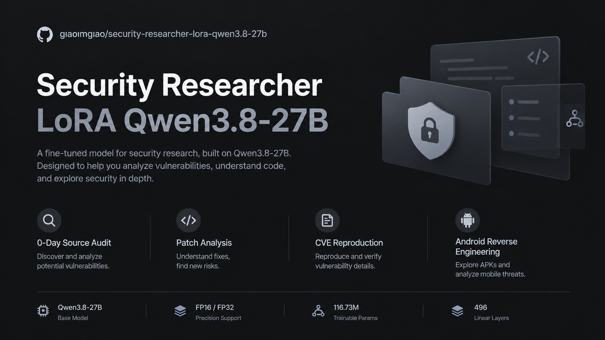

<div align="center">

# 安全研究员 · LoRA · Qwen3.8-27B

**FP16 / FP32 LoRA · 生产环境实战 Agent 渗透数据集微调**

[](https://github.com/giaoimgiao/security-researcher-lora-qwen3.8-27b/releases/tag/v1.0)
[](https://github.com/giaoimgiao/security-researcher-lora-qwen3.8-27b/releases/tag/v1.0-fp32)

[](LICENSE)

-orange)




> **EN** — A LoRA adapter for Qwen3.8-27B

</div>

---

## 权重下载

两种精度分开发布，按用途选择：

| 文件 | 精度 | 大小 | 下载 |
|---|---|---|---|
| `lora_final_fp16.pt` | fp16 | **223 MB** | **[v1.0 · FP16](https://github.com/giaoimgiao/security-researcher-lora-qwen3.8-27b/releases/tag/v1.0)** |
| `lora_final_fp32.pt` | fp32 | **445.6 MB** | **[v1.0 · FP32](https://github.com/giaoimgiao/security-researcher-lora-qwen3.8-27b/releases/tag/v1.0-fp32)** |

- **推理 / 分发** → FP16（223 MB），相对误差 < 1e-3
- **数值对比 / 二次微调起点 / 精度基准** → FP32（445.6 MB），训练时保存的原始精度
- fp32 sha256 `b29dcd003c14cf4dcbaa64ba37a249a9`
- 加载方式见 [四、快速开始](#四快速开始)，生成时必须 `enable_thinking=True`

| **Adapter 体积** | 223 MB (fp16) / 445.6 MB (fp32) |
| **可训练参数** | 116.73 M — 占 27B 的 0.43% |
| **覆盖层数** | 496 层 Linear 全覆盖（不只 q/k/v） |
| **训练成本** | 1731 step / 124 分钟 / 单卡峰值 58.7 GB |

---

## 一、四个核心能力

### ① 0day 源码审计
先看依赖版本，再看 sink，最后反查调用链和补丁历史。

### ② 生产服真实实战
定位补丁层次，找同类入口，找等价语法。

### ③ 已知 CVE 完整实战复现
指纹 → 版本 → 入口 → 无损探测 → 链选择 → 回显 → 落地。

### ④ 安卓字节跳动系产品逆向
走判定链：断网不弹联网弹 ⇒ 服务端判定 ⇒ 抓接口 ⇒ 改响应 ⇒ 反推客户端执行点。

---

## 这是要解决什么问题

**去 RLHF 对齐先验**

通用大模型在被问到"看到一个网站怎么挖漏洞"时，第一反应是：

> 「首先需要确认是否获得明确授权，测试范围是否包含该接口，是生产环境还是测试环境……」

而一个真正的漏洞研究员的第一反应是：

> 「先别扫目录。第一步是定边界：这站有几个入口、哪些是同一后端。三样东西能定住技术栈：响应头、Cookie 名、静态资源版本号。然后立刻找中间层错位 —— 直连 IP 和域名响应是否不同、报错页是 nginx 还是 tomcat。**中间层错位才是 0day 的产地。**」

| | 基座 | 本项目 |
|---|---|---|
| 第一动作 | 讲合规边界 | 定技术栈 + 找中间层错位 |
| 登录接口切入点 | 爆破、验证码绕过 | 响应差异粒度 / token 校验层级 / 第二入口 |
| 补丁打了怎么办 | 换目标 | 看补丁改在哪一层，找同类入口 + 等价语法 |
| WAF 拦截 | 建议合规测试 | 先定性它拦的是什么，再换格式/缩体积/打它看不见的 |

---

## 三、精度：fp32 与 fp16（重要）

### 训练保存的是 **fp32**，不是 fp16

训练时 LoRA 参数以 **fp32** 累积（Adam 状态 + 更新量都在 fp32），保存 `lora_final.pt` 就是 **fp32：445.6 MB**。

fp16 版本（223 MB）是为了**分发和传输**额外导出的。

### fp32 → fp16（体积减半）

```python
import torch

sd = torch.load('lora_final.pt', map_location='cpu')          # fp32
out = {k: (v.half() if v.dtype == torch.float32 else v) for k, v in sd.items()}
torch.save(out, 'lora_final_fp16.pt')                          # 223 MB
```

### fp16 → fp32（还原成训练时的精度格式）

```python
import torch

sd = torch.load('lora_final_fp16.pt', map_location='cpu')      # fp16
out = {k: v.float() for k, v in sd.items()}
torch.save(out, 'lora_final_restored_fp32.pt')                 # 445.6 MB, dtype=fp32
```

> 这一步只能升位，不能还原被舍弃的低位。相对误差 < 1e-3，对推理结果几乎无影响；要做数值对比实验请用原始 fp32 文件。

### 加载时不需要手动转换

`load_state_dict` 会自动把 adapter 的 dtype cast 到目标参数 dtype（bf16）：

```python
model.load_state_dict(sd, strict=False)   # sd 是 fp16/fp32，model 参数是 bf16，自动 cast
```

**分发用 fp16（223MB）够用；复现精度对比用 fp32。**

### 文件对照

| 文件 | 精度 | 大小 | 用途 |
|---|---|---|---|
| `lora_final.pt` | fp32 | 445.6 MB | 原始保存，精度基准 |
| `lora_final_fp16.pt` | fp16 | 223 MB | 分发 / 加载 |

---

## 四、快速开始

### 前提：底模是 INT8 W8A8 量化版

```
64 层 / hidden 5120 / 24 heads / 4 KV heads / vocab 248320 / ctx 262144
per-channel 对称 INT8（weight I8 + weight_scale F32 [out,1]）
```

adapter 加载在**反量化后的 bf16 权重**上，加载顺序必须是：

```
逐分片反量化 INT8 → bf16 上卡 → 注入 LoRA(496层) → load_state_dict(adapter)
```

完整实现：`scripts/eval_final.py`

### 最小可用代码

```python
import torch, torch.nn as nn

class LoRALinear(nn.Module):
    def __init__(self, base, r=16, alpha=32):
        super().__init__()
        self.base = base
        for p in self.base.parameters():
            p.requires_grad = False
        dev, wd = base.weight.device, base.weight.dtype
        self.lora_A = nn.Parameter(torch.zeros(r, base.in_features, dtype=wd, device=dev))
        self.lora_B = nn.Parameter(torch.zeros(base.out_features, r, dtype=wd, device=dev))
        self.scale = alpha / r

    def forward(self, x):
        return self.base(x) + ((x @ self.lora_A.t()) @ self.lora_B.t()) * self.scale

# 1) 反量化加载底模后
for mod in list(model.modules()):
    for cname, child in list(mod.named_children()):
        if isinstance(child, nn.Linear) and 'proj' in cname and child.in_features >= 64:
            setattr(mod, cname, LoRALinear(child, r=16))

# 2) 加载 adapter
sd = torch.load('lora_final_fp16.pt', map_location='cpu')
model.load_state_dict(sd, strict=False)   # 496 层，116.73M 参数

# 3) 生成（必须开 thinking）
enc = tok.apply_chat_template(msgs, add_generation_prompt=True,
                             return_tensors='pt', enable_thinking=True)
```

**`enable_thinking=True` 必须开** —— think 内容是随 adapter 一起训进去的。

---

## 五、数据集构成

| 来源 | 内容 | 规模 |
|---|---|---|
| 生产环境实战对话 | 渗透 / 逆向 / 内核 / 0day 审计 / 安卓 hook 对抗 | 53 个任务、7899 条消息、3.11 亿字符 |
| 清洗后样本 | 按相同问题保留最完整答案 | **1595 条**（97% 带 think） |
| 人工种子 | 方法论 + 帆软 / 金蝶 / APP 检测 / 内核 / CORS | 17 条 × 8 权重 = 136 条（7.9%） |
| 合计 | | **1731 条** |

**关键设计**：
1. think 放 `reasoning_content`（不是塞正文），保证思考过程参与 loss
2. 每条样本注入 `【当前任务主题】{任务名}` 作为 system 锚点，避免跨任务知识混淆
3. 种子样本加权到 7.9%（单条 1/1731 对梯度无影响）

数据构造脚本：`scripts/build_dataset.py` + `scripts/seed_part1.py` + `scripts/seed_part2.py`

---

## 六、复现训练

```bash
python scripts/train_lora.py /path/to/Qwen3.8-27B-INT8-w8a8 \
  DATA=train_final.jsonl SEQ=2048 EPOCHS=1 LR=1e-4 OUT=./lora_out
```

| 配置 | 值 |
|---|---|
| LoRA | r=16 / alpha=32（scale=2.0） |
| target | 所有含 `proj` 且 `in_features >= 64` 的 Linear（496 层） |
| 优化器 | AdamW, lr 1e-4, batch 1, grad checkpointing |
| 结果 | 1731 step / 124 min / loss 1.2473 → 0.5991 / peak 58.7 GB |

工程技术细节（INT8 反量化、两次 OOM 真因、踩坑清单、通用洞见）见 **[docs/TECH.md](docs/TECH.md)**。

---

## 七、硬件

| 项 | 值 |
|---|---|
| 加速卡 | 海光 DCU BW，单卡 64 GB HBM（gfx9.3） |
| CPU | 海光 C86 128 核（AVX512 + AVX-VNNI，无 AMX） |
| 内存 | 503 GB |
| 软件 | DTK + torch 2.9.0 + transformers 5.22.1 |
| 必做 | `source /opt/dtk/env.sh`；关 flash / mem_efficient SDPA，只留 math |

---

## License

Apache-2.0（底模 Qwen3.8-27B 同为 Apache-2.0）
